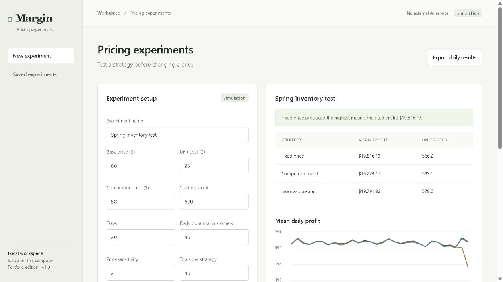

# Margin — Pricing experiments

Reproducible inventory and demand simulations for comparing pricing strategies.

## Run locally

Requires Python 3.11+. Run from this project folder:

    py -m venv .venv
    .venv\Scripts\python.exe -m pip install -r requirements.txt
    .venv\Scripts\python.exe run.py

Open http://127.0.0.1:8903. On macOS/Linux use python3 and .venv/bin/python instead. Install requirements-dev.txt and run python -m pytest -q for tests.

## Data and access

Runs on loopback. This is a local portfolio application, not a configured production service. SQLite and generated model files live in ignored data/; back up that folder. APP_DATA_DIR selects another data location. Public source contains no personal data or credentials. Demo data is synthetic and labeled. Imports stay on the local server. No paid AI API is used. HTTPS, deployment authentication and operational monitoring must be added before remote exposure.

## Simulation design

Compare fixed pricing, competitor matching and an inventory-aware price rule over paired Monte Carlo trials. Each strategy receives the same seeded Poisson arrivals and customer random draws. Prices stay within 65–140% of base price and above cost plus 5%; no units can be sold after stock runs out. The inventory rule lowers prices when stock is ahead of the planned remaining-stock path and raises prices when stock is depleted faster.

Reports mean profit/revenue/units, 10th–90th percentile profit, daily price/profit/stock series, and persistent saved runs. Repeating the same inputs and seed reproduces strategy results. Daily series can be exported as CSV. Trial count/day bounds constrain resource use.

This is an assumed logistic demand model, not a learned elasticity forecast. No competitor website is scraped or live price changed. There is no replenishment, tax, return, advertising or carrying-cost model; unsold inventory remains valued at cost. Do not interpret simulated profit as actual business performance.

APIs: GET /api/experiments and /api/experiments/{id}; POST /api/experiments.

## Interface preview

## Validation

Automated tests cover the local HTTP boundary and project-specific workflows. Browser checks cover the rendered interface and primary interactions. Dependency versions used for validation are pinned in constraints.txt. The screenshots show synthetic/example data, not customer information.
